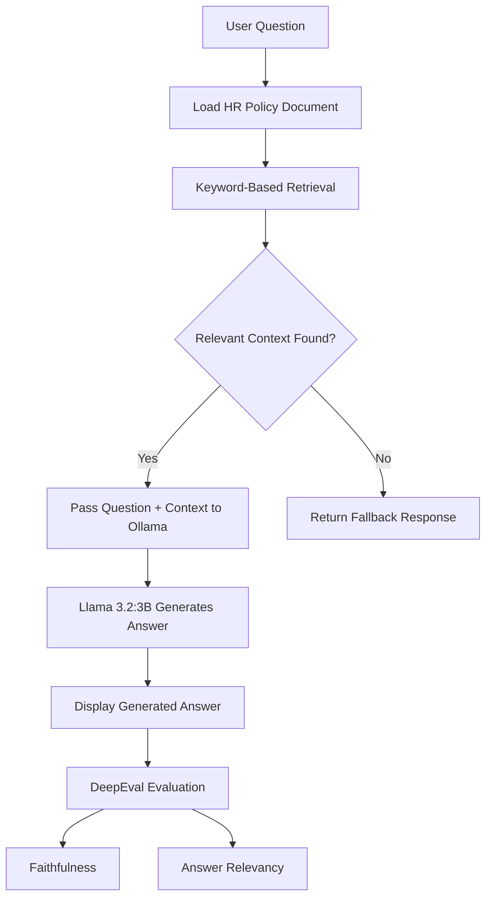

# GroundLens – RAG Application & LLM Evaluation

## Project Overview

GroundLens is a Python-based Retrieval-Augmented Generation (RAG) application that answers questions using an HR policy document.

It retrieves relevant information from the document and uses a locally hosted LLM (Llama 3.2:3B through Ollama) to generate context-grounded answers.

The project also includes automated testing using Pytest and LLM response evaluation using DeepEval.

## Architecture

1. Load the HR policy document.
2. Retrieve relevant policy information using keyword-based retrieval.
3. Pass the retrieved context and user question to the LLM.
4. Generate an answer based on the retrieved context.
5. Return a fallback response when relevant information is unavailable.
6. Evaluate the generated response using DeepEval.

## Project Structure

```text
GroundLens/
│
├── data/
│   └── hr_policy.txt
│
├── tests/
│   ├── test_rag.py
│   └── test_faithfulness.py
│
├── rag.py
├── requirements.txt
├── README.md
└── .gitignore
```

## Tech Stack

- Python
- Ollama
- Llama 3.2:3B
- Pytest
- DeepEval

## Testing

The project includes:

- Retrieval validation tests.
- Negative test scenarios.
- Alternative question phrasing tests.
- Parameterized DeepEval tests.
- Faithfulness evaluation.
- Answer relevancy evaluation.
- Unsupported-question handling.

## Project Limitations

- Retrieval currently uses keyword matching rather than semantic or vector search.
- The application uses a small local language model.
- Evaluation results depend on the evaluator model.

## Prerequisites

- Python installed.
- Ollama installed and running.
- Llama 3.2:3B model downloaded.

## Running the Project

Install dependencies:

```bash
pip install -r requirements.txt
```

Ensure Ollama is running and the `llama3.2:3b` model is available.

Run retrieval tests:

```bash
python -m pytest tests/test_rag.py -v
```

Run LLM evaluation tests:

```bash
python -m pytest tests/test_faithfulness.py -v
```

Run all tests:

```bash
python -m pytest -v
```

## Project Goal

To explore practical RAG implementation, automated validation, LLM evaluation, and hallucination detection in a document-based question-answering application.


## RAG Workflow


